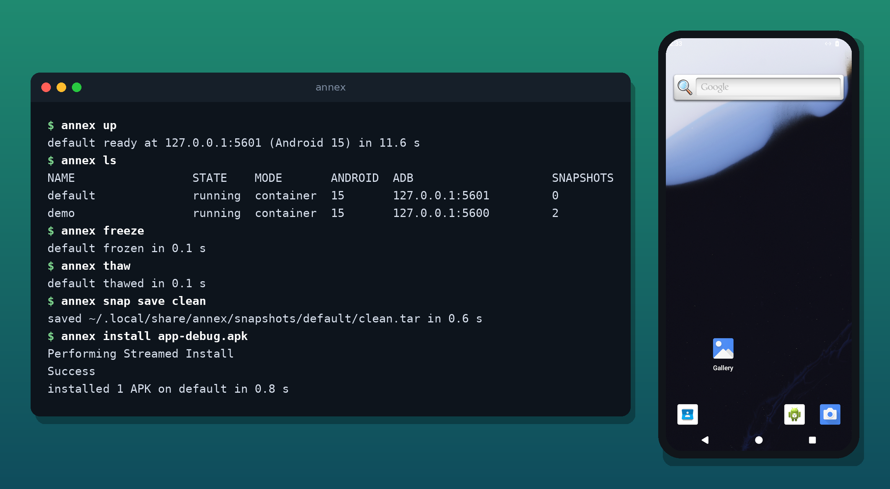
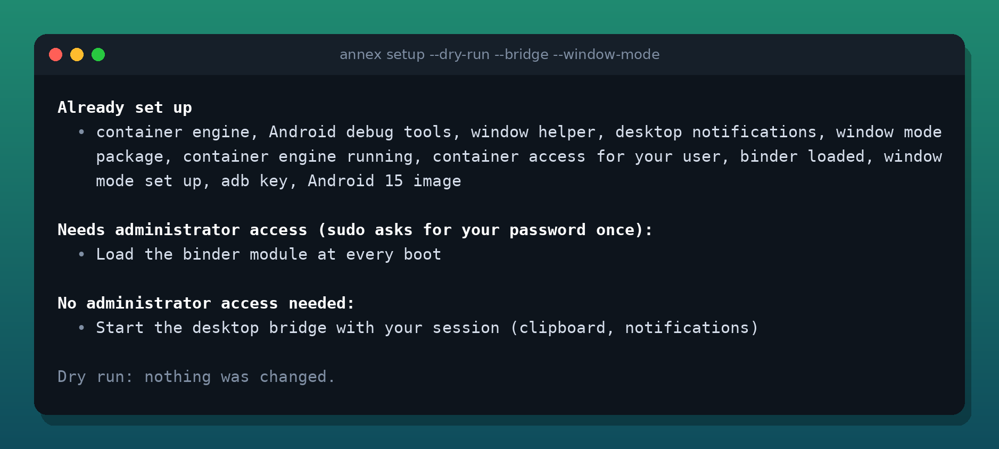
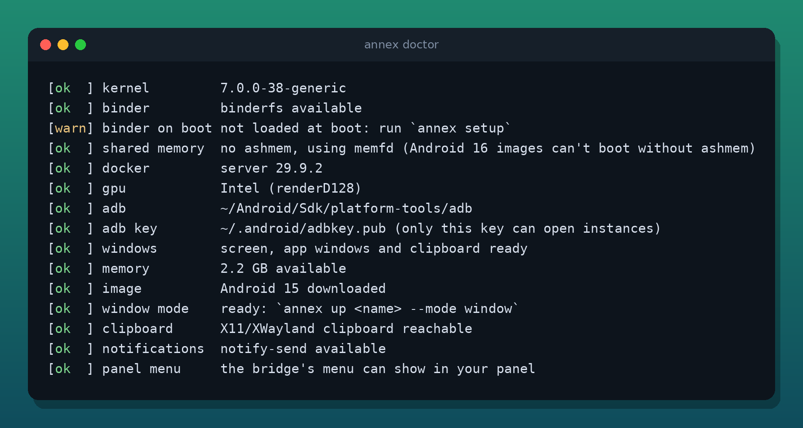

<p align="center">
  
</p>

<h1 align="center">annex</h1>

<p align="center">
  <a href="https://github.com/cyenite/annex/actions/workflows/ci.yml"></a>
  <a href="LICENSE"></a>
</p>

**Fast Android instances for Linux developers.** An instance boots in about 20 seconds, freezes and thaws in a fifth of a second, and shows up in Android Studio, Flutter and adb as an ordinary device.



## Install

annex is a single binary. You need Rust 1.88 or newer to build it:

```sh
cargo install --git https://github.com/cyenite/annex
annex setup
```

Tagged releases also publish a prebuilt x86_64 Linux binary on the [Releases page](https://github.com/cyenite/annex/releases).

To update later, run `annex update`. It installs the latest release after checking its SHA-256, or rebuilds the latest source while no release is published; `annex update --check` only looks.

### What `annex setup` does

`annex setup` checks the machine, then shows what it will change, split into what needs administrator access and what doesn't, and asks once. It can:

- load the Android binder kernel module now and at every boot;
- install the container engine, the Android debug tools and the window helper with your distribution's package manager (apt, dnf, pacman or zypper);
- let your user run containers without sudo;
- keep the disk images Android mounts inside each instance from showing up as drives in your dock and file manager;
- download the Android 15 image, with live speed and time left;
- with `--bridge`, run the desktop bridge with your session;
- with `--window-mode`, set up window mode.



sudo asks for your password once; annex never sees it. Setup is safe to re-run: anything already in place is skipped. `--dry-run` shows the plan without changing anything, `--yes` skips the question for scripts, and `--repair` resets window mode's system service when it gets out of sync.

You can also check without changing anything: `annex doctor`.



### Requirements

- **x86_64 Linux** with a kernel that has Android binder support. Ubuntu's kernel, Arch's linux-zen and Fedora's kernel do.
- **An Intel or AMD GPU** for hardware rendering. NVIDIA works with software rendering.
- Everything else, `annex setup` installs.

## Quick start

```sh
annex setup               # check this machine, show the plan, fix what's missing
annex up                  # start the `default` instance (Android 15) and open its window
flutter run -d 127.0.0.1:5600
```

`annex up` prints the instance's adb serial and opens its window; `--no-window` skips the window, and none opens outside a desktop session, so scripts and CI are unaffected. Android Studio lists the instance in the device picker like any phone, and it appears in your desktop's app launcher.

## Why annex

annex runs Android in a container on your own kernel instead of a virtual machine. On the reference machine, the edit, install and launch loop was about 8x faster than an Android Studio emulator, and idle memory was about a third.

| | Android Studio emulator | annex |
|---|---|---|
| Cold boot | 70.7 s | 17.9 s |
| Resume | 6.6 s | 0.16 s |
| Reinstall + launch an app | 17.3 s | 2.0 s |
| Idle memory | 1.39 GB | 0.53 GB |

Medians of 3 runs on an i7-1365U laptop with Intel graphics. Method and raw data: [phase0/RESULTS.md](phase0/RESULTS.md).

## Using annex

Commands that act on one instance take its name. Leave the name out to mean `default`, or the only running instance.

### Instances

```sh
annex up                                # create or start `default` (Android 15), open its window
annex up old --android 13               # another instance, on Android 13
annex up tablet --display 1600x2560/320 # screen size and density
annex ls                                # list instances
annex down old                          # stop; data is kept
annex rm old                            # delete the instance and its data
```

Instances listen for adb on `127.0.0.1:5600` and up, outside the 5555-5585 range that adb scans for emulators. Changing `--display` on an existing instance rebuilds it and keeps its data.

### Freeze, snapshots and reset

```sh
annex freeze                            # pause in memory, about 0.1 s
annex thaw                              # resume, about 0.1 s
annex snap save logged-in               # save all app data under a label
annex snap ls
annex reset default --to logged-in      # restore that snapshot (about 20 s)
annex reset default                     # back to first boot
```

Snapshots are taken while the instance is frozen, so they are consistent without a reboot. `reset` and `rm` always need the instance's name.

### Apps, windows and files

```sh
annex install app-debug.apk             # install or update, permissions granted
annex show                              # a window with the whole screen
annex open com.example.app              # one app in a desktop window of its own
annex push ~/fixtures/photo.jpg         # into /sdcard/Download by default
annex pull /sdcard/Download/report.pdf
```

To target a specific instance, put its name first: `annex install pixel app-debug.apk`.

## On your desktop

### App launcher

Every instance gets an entry in your app launcher and dock. Clicking it starts the instance if needed and opens its screen; right-click for Freeze, Thaw, Stop and Reset to any snapshot. `annex up` adds the entry and `annex rm` removes it; `annex launcher install` and `annex launcher remove` do it by hand. Launchers report problems as desktop notifications.

### Desktop bridge and panel menu

The bridge keeps one clipboard across your desktop and every running instance, shows Android notifications as desktop notifications, and puts an annex menu in your panel. The menu lists every instance with its state and offers Show, Freeze or Thaw, Snapshot now, Reset to, Stop, and New instance.

```sh
annex bridge install        # run it with your desktop session (or: annex setup --bridge)
annex bridge status
annex bridge run --verbose  # or run it in the foreground
```

The bridge attaches to instances as they start and detaches when they stop or freeze. On GNOME, the panel menu needs the AppIndicator extension, which Ubuntu enables by default; KDE shows it natively. Logs: `journalctl --user -u annex-bridge -f`.

## Two modes

Instances run in **container mode** unless you ask for **window mode**:

```sh
annex up desk --mode window
annex open desk com.example.app   # opens in a native desktop window
```

| | Container mode (default) | Window mode |
|---|---|---|
| Instances | as many as you like | one |
| Android versions | 13, 14, 15 | from its system image |
| App windows | `annex open`, mirrored | native desktop windows |
| Freeze and thaw | yes | yes |
| Snapshots and reset | yes | no |
| Clipboard and notifications | through the desktop bridge | built in |

Set window mode up first with `annex setup --window-mode`.

## Security

Container-mode instances run as privileged containers, so each one is root-equivalent on the host. annex keeps them closed to other local users:

- adb only accepts your adb key (`~/.android/adbkey.pub`). Any other key is `unauthorized`, including through the container's network address.
- Nothing else listens: the simulated Bluetooth service, which opens network ports, is disabled.
- Snapshots, which contain every app's private data, are readable only by you.
- The bridge never logs clipboard contents, only sizes.

Anyone in the `docker` group can still open a shell in an instance, as with any container. See [SECURITY.md](SECURITY.md) to report a vulnerability.

## Limits

- **No Google Play.** Apps that need Play Integrity (banking, some games) will not run. Use a real device or an emulator for those.
- **No Android 16 yet.** Its system services need a kernel feature (ashmem) that mainline kernels no longer have.
- **x86_64 Linux only** for now.

## Troubleshooting

| Symptom | Fix |
|---|---|
| `annex up` fails at once | Run `annex doctor`, then `annex setup` to fix what it reports. |
| The device shows up twice in adb | Something published adb on 5555-5585. annex uses 5600 and up; remove the other mapping. |
| Android Studio loses its devices | Two adb versions on one machine kill each other's server. Point Studio and your PATH at the SDK's adb. |
| A Flutter debug build crashes on launch | The APK was built for a phone (arm64). Let `flutter run` build for the instance, which is x86_64. |
| Window mode won't freeze, saying its state is out of sync | Run `annex setup --repair`. |
| No annex menu in the panel | On GNOME, enable the AppIndicator extension; `annex doctor` checks for it. |
| Dozens of small drives fill the dock while an instance runs | Run `annex setup`. Android mounts each of its system modules as a disk image, and setup tells your desktop to ignore them. |

## How it works

annex is a thin, stateless layer. A container-mode instance is a container named `annex-<name>` with a data volume; its port, Android version and display live in the container's labels, so there is no state file to drift. Freezing pauses the container's processes in place. Snapshots stream the data volume out of the frozen container. The desktop bridge runs a small helper on each instance and speaks its control protocol to share the clipboard, and it watches Android's notification service for new notifications.

annex builds on several open-source projects; `annex about --licenses` and [THIRD_PARTY_NOTICES.md](THIRD_PARTY_NOTICES.md) list them with their licenses. The plan and what comes next: [ROADMAP.md](ROADMAP.md). Changes by version: [CHANGELOG.md](CHANGELOG.md).

## Contributing

Bug reports, fixes and new ideas are welcome. Start with [CONTRIBUTING.md](CONTRIBUTING.md).

## License

[Apache-2.0](LICENSE)
